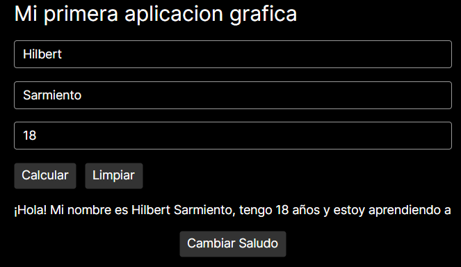
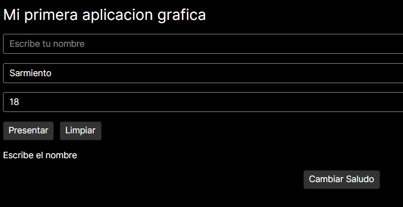
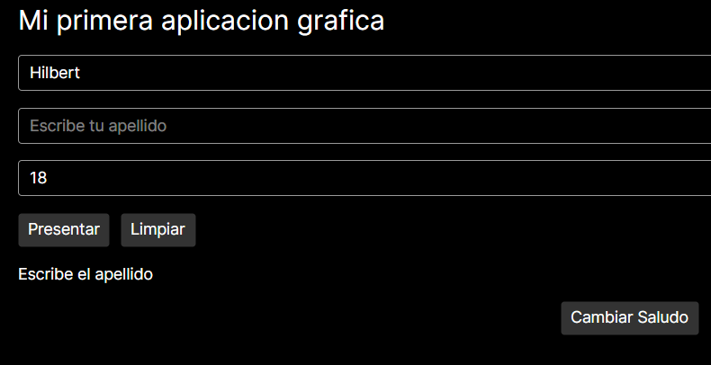
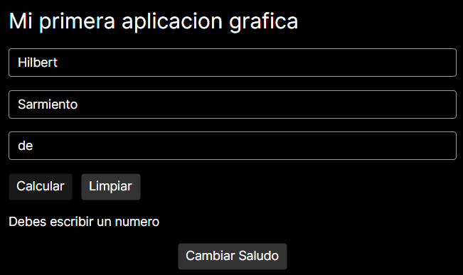
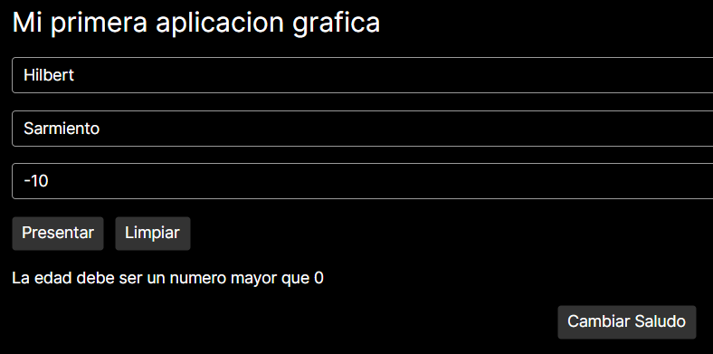
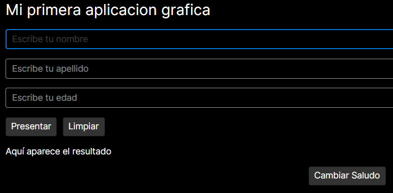
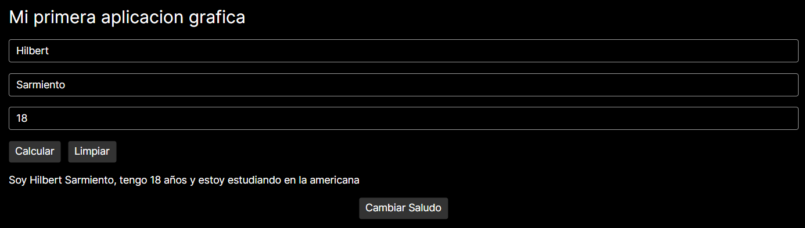

# MiPresentacion

## Descripción

MiPresentacion es una aplicación de escritorio desarrollada con **C#**, **Avalonia UI 11** y **.NET 8**. Permite ingresar un nombre, un apellido y una edad, y al presionar el botón **Presentarme** muestra una presentación personalizada. La aplicación valida los datos y muestra mensajes de advertencia cuando alguno es incorrecto.

## Controles utilizados

| Control | Uso en la aplicación |
|---|---|
| `StackPanel` | Organiza los controles en vertical (y los botones Presentarme y Limpiar en horizontal), usando `Margin` y `Spacing`. |
| `TextBlock` (título) | Muestra «Mi primera aplicación gráfica». |
| `TextBox` `Nombre`, `Apellido`, `Edad` | Reciben los datos del usuario. Tienen `x:Name` para usarlos desde C#. |
| `Button` Presentarme | Valida los datos y muestra la presentación. |
| `Button` Limpiar | Vacía los campos, restaura el mensaje inicial y devuelve el cursor al nombre. |
| `Button` Cambiar Saludo | Alterna entre dos mensajes de presentación. |
| `TextBlock` `Resultado` | Muestra el saludo o los mensajes de advertencia. |

## Funcionamiento de los eventos

Cada botón tiene un evento `Click` declarado en `MainWindow.axaml` y programado en `MainWindow.axaml.cs`:

- **Presentarme** (`Button_OnClick`): lee el texto de cada `TextBox` y valida en orden:
  1. Que el nombre no esté vacío ni tenga solo espacios (`string.IsNullOrWhiteSpace`).
  2. Que el apellido cumpla lo mismo.
  3. Que la edad sea un número entero (`int.TryParse`).
  4. Que la edad sea mayor que 0.

  Si alguna validación falla, muestra una advertencia en `Resultado` y termina con `return`. Si todas pasan, muestra el saludo.
- **Limpiar** (`Button_Clean`): vacía los tres `TextBox`, restaura el mensaje inicial y llama a `Nombre.Focus()`.
- **Cambiar Saludo** (`Button_Saludo`): usa una variable booleana de clase (`saludo`) que recuerda cuál mensaje se mostró y alterna entre los dos sin cerrar la aplicación.

## Mensajes de validación

| Situación | Mensaje |
|---|---|
| Nombre vacío | "Escribe el nombre" |
| Apellido vacío | "Escribe el apellido" |
| Edad con letras | "Debes escribir un numero" |
| Edad menor o igual a 0 | "La edad debe ser un numero mayor que 0" |

## Casos de prueba

| Caso | Datos introducidos | Resultado esperado | Resultado obtenido |
|---|---|---|---|
| 1 | Datos válidos | Muestra la presentación | Sin Errores |
| 2 | Nombre vacío | Muestra una advertencia | Sin Errores |
| 3 | Apellido vacío | Muestra una advertencia | Sin Errores |
| 4 | Edad con letras | Solicita una edad numérica | Sin Errores |
| 5 | Edad negativa o cero | Rechaza la edad | Sin Errores |
| 6 | Presionar Limpiar | Restablece el formulario | Sin Errores |

## Capturas de pantalla









## Instrucciones para ejecutar

1. Instala el SDK de .NET 8: https://dotnet.microsoft.com/download
2. Abre una terminal y entra a la carpeta del proyecto:
   ```
   cd "ruta\de\la\carpeta\MiPresentacion"
   ```
3. Ejecuta:
   ```
   dotnet run
   ```

## Pregunta de reflexión

(Escribe aquí tu respuesta con tus propias palabras.)
